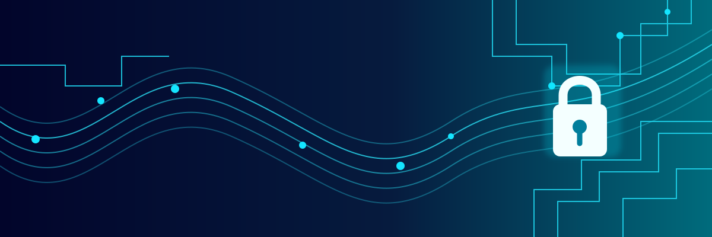

# 👋 Hi, I'm Pratibha Kumari

### 🔐 Cybersecurity Analyst Intern · DFIR · AI/ML for Security

  

  
  

  

---

## 👩‍💻 About Me

I'm a **B.Tech Computer Science Engineering student specializing in Cybersecurity at Rashtriya Raksha University (RRU), Gandhinagar**. My work and learning interests span Digital Forensics & Incident Response (DFIR), SOC and blue-team fundamentals, threat analysis, network reconnaissance, and applying machine learning to security problems.

- 🛡️ **Cybersecurity Analyst Intern** at VicyTech — DFIR focus (Aug 2026 – Feb 2027)
- 🤖 **AI & ML Intern** at IICT, New Delhi (Jun 2026 – Jul 2026)
- 🎓 B.Tech CSE (Cybersecurity), RRU (2025–2028) — GPA: 7.05
- 🎓 Diploma in Computer Science Engineering, Government Women's Polytechnic College (2022–2025) — GPA: 8.89
- 🧪 Interested in SOC alert triage, IOC investigation, digital forensics, threat intelligence, and AI security
- 🐍 Building with Python; strengthening security fundamentals and practical investigation skills

---

## 🧰 Technical Skills

| Area | Skills & Tools |
|---|---|
| **Security & Reconnaissance** | Nmap, Nikto, Burp Suite, OWASP ZAP, Google Dorking, OSINT, network reconnaissance |
| **Blue Team & DFIR** | DFIR fundamentals, SOC/Blue Team fundamentals, SIEM/EDR fundamentals, IOC investigation, Cyber Kill Chain |
| **Network & Systems** | TCP/IP, routing and switching, DNS tools (nslookup, dig), Cisco Packet Tracer, Linux basics, Windows |
| **Programming** | Python, C, SQL, Java (Swing), JavaScript |
| **AI / ML & Data** | scikit-learn, XGBoost, Pandas, NumPy, Matplotlib, Seaborn, NLP/text classification, SHAP |
| **Development & Tools** | MongoDB, Node.js (basic), HTML5, CSS3, Streamlit, Git, VS Code, Arduino IDE, MATLAB |
| **Special Topics** | AI Security, Adversarial ML, secure coding, secure system design, OT/ICS security fundamentals, cryptography basics |

  

---

---

---

## 📊 GitHub Analytics

  
  

  

  

---

## 🎯 Current Focus

- Digital Forensics & Incident Response (DFIR)
- SOC operations, alert triage, and IOC investigation
- Threat intelligence and network reconnaissance
- AI/ML applications for phishing and other security problems
- OT/ICS security fundamentals
- Python and Data Structures & Algorithms

---

## 🤝 Connect

  
  

<b>“Learn continuously. Investigate carefully. Build securely.”</b>

