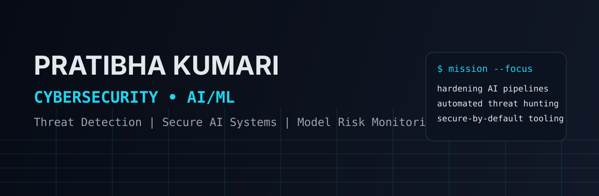
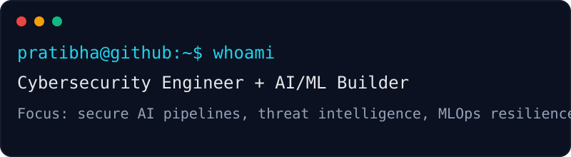

<div align="center">



# 👋 Hi, I'm Pratibha Kumari

### 🔐 Cybersecurity Engineer | 🤖 AI/ML Practitioner


</div>

---

## 🧠 Professional Identity

I build **secure, intelligent systems** at the intersection of:
- Cybersecurity engineering
- AI/ML development
- Threat detection and resilient MLOps

I enjoy turning security and ML ideas into practical, production-ready solutions.



---

## 🛠️ Core Toolkit


---

## 📊 GitHub Statistics

<div align="center">


</div>

---

## 🚀 Repository Presentation (Featured)

> Replace these links with your strongest projects to keep your profile consistently curated.

| Project | Focus Area | Why it stands out |
|---|---|---|
| [🔒 AI Threat Detection](https://github.com/Pratibh-kumari) | Cybersecurity + ML | End-to-end detection workflow |
| [🧪 Secure MLOps Pipeline](https://github.com/Pratibh-kumari) | MLOps Security | Model governance + pipeline hardening |
| [📈 Security Analytics Toolkit](https://github.com/Pratibh-kumari) | Data + Detection | Actionable insights for incident response |

---

## ⚙️ Exact Setup Instructions

1. **Keep this repository named exactly like your username** (`Pratibha-Kumari`) so GitHub renders it as your profile.
2. Add the asset files in `assets/`:
   - `assets/cybersecurity-dark-banner.svg`
   - `assets/cyber-terminal-card.svg`
3. Ensure `README.md` references assets using relative paths:
   - `./assets/cybersecurity-dark-banner.svg`
   - `./assets/cyber-terminal-card.svg`
4. Verify your username in all dynamic cards:
   - `github-readme-stats` → `username=Pratibh-kumari`
   - `streak-stats` → `user=Pratibh-kumari`
   - profile views badge → `username=Pratibh-kumari`
5. Commit and push:

   ```bash
   git add README.md assets/
   git commit -m "Create cybersecurity-dark GitHub profile makeover"
   git push
   ```

6. (Optional) Pin your top repositories from **GitHub Profile → Customize your pins** to match the Featured section.

---

## 🤝 Connect

- GitHub: [@Pratibh-kumari](https://github.com/Pratibh-kumari)

